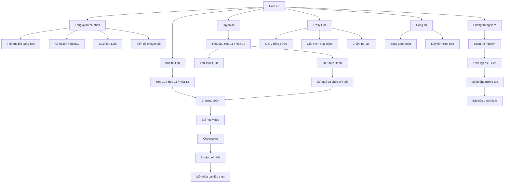

# HóaLab product map

HóaLab tập trung vào một vòng lặp học tập có thể đo lường: **Học → Luyện → Thi → Phân tích → Học bù**. Thí nghiệm ảo và Trợ lý Hóa là công cụ hỗ trợ theo ngữ cảnh, không phải các luồng độc lập cạnh tranh sự chú ý.

## Tính năng cốt lõi

1. **Kho tài liệu:** cây nội dung Hóa 10, 11, 12 theo bộ SGK; demo hiện tập trung 8 chương, 30 bài Hóa 12 Kết nối tri thức.
2. **Luyện đề:** luyện nhanh, phòng thi có giám sát và chữa bài chi tiết.
3. **Phòng thí nghiệm:** mô phỏng hiện tượng và cơ chế phản ứng, tạo báo cáo thực hành.
4. **Trợ lý Hóa:** hỗ trợ theo từng bước và chấm phần tự luận; không thay học sinh làm bài.
5. **Tổng quan cá nhân:** chỉ hiển thị việc cần làm tiếp theo, mục tiêu và tiến độ.

## Những phần không còn là điều hướng chính

- Game Hóa học: chỉ nên xuất hiện như một loại hoạt động trong bài học.
- Cộng đồng: hoãn đến khi có cơ chế kiểm duyệt và giá trị học tập rõ ràng.
- Tài liệu PDF: gắn vào từng bài trong Kho tài liệu hoặc mục Công cụ.
- Mini chat AI trên Dashboard: thay bằng lối tắt theo ngữ cảnh để giảm nhiễu.

## Nguyên tắc giao diện

- Một màn hình có một hành động chính.
- Không dùng gradient để trang trí mọi thẻ; màu chỉ thể hiện trạng thái hoặc phân loại.
- Giảm bo góc, bóng đổ và badge không cần thiết.
- Nội dung học và tiến độ xuất hiện trước hoạt động khám phá.
- AI hiện diện như một công cụ hỗ trợ, không phải ngôn ngữ hình ảnh của toàn sản phẩm.
